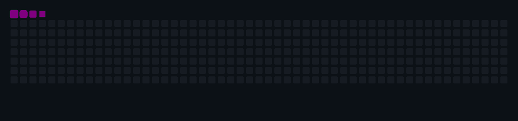

<div align="center">

<!-- PIXEL-ART RETRO ARCADE HEADER BANNER -->


  <!-- SUBTLE ANIMATED TYPING INTRODUCTION -->
  <a href="https://github.com/ruthvikroy">
    
  </a>

  <br />

  <!-- MINIMAL SOCIAL NAVIGATION -->
  <p>
    <a href="https://github.com/ruthvikroy">
      
    </a>
    &nbsp;
    <a href="https://www.linkedin.com/in/ruthvikroy/">
      
    </a>
    &nbsp;
    <a href="mailto:ruthvikroy3@gmail.com">
      
    </a>
  </p>

</div>

---

## 01. Editorial Profile

<table>
<tr>
<td width="62%" valign="top">

### Engineering Logic Meets Visual Discipline

I am a **developer and creative technologist** focused on **Python development**, **C programming**, **AI-powered application prototyping**, and **cloud technologies**, backed by **3+ years of graphic design experience**.

My work sits at the convergence of structured engineering and visual communication. Graphic design trained me to think in grids, hierarchy, and human perception; programming in Python and C gives me the tools to turn those concepts into functional, deterministic systems.

Whether I am writing foundational algorithms, experimenting with generative AI workflows, or exploring cloud infrastructure, my objective remains consistent: **build software that is technically sound and visually intentional.**

</td>
<td width="38%" valign="top">

### Identity Matrix

| Attribute | Specification |
| :--- | :--- |
| **Core Languages** | Python, C |
| **Creative Foundation** | 3+ Years Graphic Design |
| **Active Exploration** | AI Prototypes & Cloud Tech |
| **Design Approach** | Minimalist · High-Contrast |
| **Primary Motivation** | Curiosity & Craftsmanship |

</td>
</tr>
</table>

---

## 02. System Terminal

```text
┌──────────────────────────────────────────────────────────────────────────────┐
│ ENVIRONMENT : RUTHVIK@DEV                    SESSION : STATIC_SYS_SNAPSHOT   │
│ USER        : RUTHVIK ROY                    STATUS  : BUILDING & EXPLORING  │
├──────────────────────────────────────────────────────────────────────────────┤
│                                                                              │
│ $ whoami --profile                                                           │
│ > Developer & Creative Technologist bridging code, AI, cloud, and design.    │
│                                                                              │
│ $ cat /etc/capabilities.conf                                                 │
│   [CORE_CODE]     Python Development · C Programming · Software Foundations  │
│   [INTELLIGENCE]  AI Prototyping · LLM Applications · Intelligent Automation │
│   [CLOUD_INFRA]   Cloud Technologies · Google Cloud Exploration              │
│   [VISUAL_CRAFT]  3+ Years Graphic Design · UI Aesthetics · Visual Systems   │
│                                                                              │
│ $ systemctl status current-directive.service                                 │
│ ● current-directive.service - Combine creative design with engineering       │
│   Active: active (running) · Focus: Build useful things. Make them clear.    │
└──────────────────────────────────────────────────────────────────────────────┘
```

---

## 03. Technical Architecture & Skill Matrix

> **Transparency Principle:** Skills are organized by actual engagement level — distinguishing between daily tools (**Actively Using**), technologies in structured study (**Currently Learning**), and emerging domains under investigation (**Exploring**).

<table>
  <thead>
    <tr>
      <th align="left" width="24%">Domain</th>
      <th align="left" width="22%">Engagement Tier</th>
      <th align="left" width="34%">Technologies & Focus Areas</th>
      <th align="center" width="20%">Verified Stack</th>
    </tr>
  </thead>
  <tbody>
    <tr>
      <td><strong>Programming Languages</strong></td>
      <td><code>ACTIVELY USING</code></td>
      <td><strong>Python</strong> (scripting, AI prototyping, automation)<br/><strong>C</strong> (structured programming, core logic)</td>
      <td align="center">
        
      </td>
    </tr>
    <tr>
      <td><strong>Artificial Intelligence</strong></td>
      <td><code>EXPLORING & PROTOTYPING</code></td>
      <td>AI-powered application development · Generative AI · LLM-based applications · Intelligent automation</td>
      <td align="center">
        
      </td>
    </tr>
    <tr>
      <td><strong>Cloud & Infrastructure</strong></td>
      <td><code>CURRENTLY LEARNING</code><br/><code>EXPLORING</code></td>
      <td>Cloud technologies · Google Cloud exploration · Deployment & infrastructure concepts</td>
      <td align="center">
        
      </td>
    </tr>
    <tr>
      <td><strong>Development Tools</strong></td>
      <td><code>ACTIVELY USING</code></td>
      <td><strong>Git</strong> · <strong>GitHub</strong> · <strong>VS Code</strong> · GitHub Actions · Vite & TypeScript/JS workspace tooling</td>
      <td align="center">
        
      </td>
    </tr>
    <tr>
      <td><strong>Creative Technology</strong></td>
      <td><code>ACTIVELY USING (3+ YRS)</code></td>
      <td><strong>Graphic Design</strong> · <strong>Visual Communication</strong> · <strong>Canva</strong> · Digital Design & UI Aesthetics</td>
      <td align="center">
        
      </td>
    </tr>
  </tbody>
</table>

---

## 04. Current Focus Dashboard

| Vector | Focus Area | Active Objective |
| :--- | :--- | :--- |
| **BUILDING** | **AI-Powered Prototypes** | Turning generative AI and LLM capabilities into clean, functional application interfaces. |
| **LEARNING** | **Cloud Infrastructure** | Exploring Google Cloud services, deployment workflows, and cloud architecture fundamentals. |
| **EXPLORING** | **Creative Technology** | Combining 3+ years of graphic design discipline with software engineering and interactive web tooling. |
| **IMPROVING** | **Python & C Foundations** | Strengthening problem-solving, algorithmic thinking, and core programming discipline. |

---

## 05. GitHub Analytics

<div align="center">

  <!-- VERIFIED OPERATIONAL SUMMARY & LANGUAGE CARDS -->
  <picture>
    <source media="(prefers-color-scheme: dark)" srcset="https://github-profile-summary-cards.vercel.app/api/cards/profile-details?username=ruthvikroy&theme=github_dark" />
    <source media="(prefers-color-scheme: light)" srcset="https://github-profile-summary-cards.vercel.app/api/cards/profile-details?username=ruthvikroy&theme=default" />
    
  </picture>
  <picture>
 

</div>

<p align="center">
  <picture>
    <source media="(prefers-color-scheme: dark)" srcset="https://streak-stats.demolab.com?user=ruthvikroy&hide_border=true&background=0B0F0D&ring=00FF87&fire=00FF87&currStreakLabel=00FF87&sideLabels=A1A1AA&dates=A1A1AA&currStreakNum=F4F4F5&sideNums=F4F4F5" />
    <source media="(prefers-color-scheme: light)" srcset="https://streak-stats.demolab.com?user=ruthvikroy&hide_border=true&background=F8FAFC&ring=059669&fire=059669&currStreakLabel=059669&sideLabels=475569&dates=64748B&currStreakNum=0F172A&sideNums=0F172A" />
    
  </picture>
</p>
<!--
  SERVICE RELIABILITY NOTE:
  The public instance at https://github-readme-stats.vercel.app is currently returning HTTP 503 (DEPLOYMENT_PAUSED).
  To guarantee zero broken images on your profile, verified operational endpoints from github-profile-summary-cards
  and streak-stats.demolab.com are active above. If you deploy your own Vercel instance of github-readme-stats,
  you can uncomment the block below:

  /api?username=ruthvikroy&show_icons=true&hide_border=true&bg_color=0B0F0D&title_color=00FF87&text_color=F4F4F5&icon_color=7C3AED" alt="GitHub Statistics" />
-->

---

## 07. Contribution Matrix

<div align="center">

  <picture>
    <source media="(prefers-color-scheme: dark)" srcset="https://raw.githubusercontent.com/ruthvikroy/ruthvikroy/output/github-contribution-grid-snake-dark.gif" />
    <source media="(prefers-color-scheme: light)" srcset="https://raw.githubusercontent.com/ruthvikroy/ruthvikroy/output/github-contribution-grid-snake.gif" />
    
  </picture>

</div>

<details>
  <summary><strong>View Alternative Snake Formats (SVG / Animated GIF)</strong></summary>
  <br />
  <div align="center">
    <p><em>Generated automatically every 24 hours via GitHub Actions (<code>Platane/snk@v3</code>) onto the <code>output</code> branch:</em></p>
    <p>
      <a href="https://raw.githubusercontent.com/ruthvikroy/ruthvikroy/output/github-contribution-grid-snake-dark.svg">Dark Theme SVG</a> ·
      <a href="https://raw.githubusercontent.com/ruthvikroy/ruthvikroy/output/github-contribution-grid-snake.svg">Light Theme SVG</a> ·
      <a href="https://raw.githubusercontent.com/ruthvikroy/ruthvikroy/output/github-contribution-grid-snake-dark.gif">Dark Theme GIF</a> ·
      <a href="https://raw.githubusercontent.com/ruthvikroy/ruthvikroy/output/github-contribution-grid-snake.gif">Light Theme GIF</a>
    </p>
  </div>
</details>

---

## 06. Connect & Collaborate

<div align="center">

  <p>Open to discussions around <strong>Python & C development</strong>, <strong>AI prototyping</strong>, <strong>cloud technologies</strong>, and <strong>design-driven software</strong>.</p>

  <p>
    <a href="https://github.com/ruthvikroy">
      
    </a>
    &nbsp;&nbsp;
    <a href="https://www.linkedin.com/in/ruthvikroy/">
      
    </a>
    &nbsp;&nbsp;
    <a href="mailto:ruthvikroy3@gmail.com">
      
    </a>
  </p>

  <br />

  <hr />

  <p>
    <code>DESIGNED WITH CREATIVITY. BUILT WITH CODE.</code>
    <br />
    <strong><code>&lt; KEEP BUILDING /&gt;</code></strong>
  </p>

</div>
