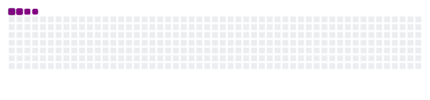

<div align="center">

<!-- PIXEL-ART RETRO ARCADE HEADER BANNER -->


<!-- ANIMATED TYPING ROLES -->
<a href="https://git.io/typing-svg">
  
</a>

<br/>

<!-- STATUS INDICATOR -->
<code>[ STATUS :: BUILDING SOMETHING INTERESTING... ]</code>

<br/><br/>

<!-- NAVIGATION ANCHOR LINKS -->
<p align="center">
  <a href="#about"><b>ABOUT</b></a>  | 
  <a href="#tech-stack"><b>TECH STACK</b></a>  | 
  <a href="#projects"><b>PROJECTS</b></a>  | 
  <a href="#github-stats"><b>GITHUB STATS</b></a>  | 
  <a href="#connect"><b>CONNECT</b></a>
</p>

</div>

---

<a id="about"></a>

## ⚡ ABOUT ME

> "I'm Ruthvik Roy — a developer and creative thinker passionate about programming, emerging cloud technologies, and AI-powered innovation. I build experimental AI prototypes, explore software development with Python and C, and bring a creative perspective through my 3 years of graphic design experience."

- **Identity:** Ruthvik Roy
- **Core Roles:** Python Developer · C Programmer · Aspiring Cloud Technologist · AI Prototype Builder · Graphic Designer (3 Years Experience)
- **Creative Edge:** Bridging disciplined software engineering with 3 years of visual & graphic design craft.

---

## 🕹️ RUTHVIK@DEV:~$

<!-- GITHUB-COMPATIBLE ARCADE TERMINAL (ASCII + SIMULATED COMMAND OUTPUT + INTERACTIVE DETAILS) -->
```ansi
┌────────────────────────────────────────────────────────────────────────────────────────┐
│ ● ● ●   RUTHVIK@DEV:~$ — RETRO ARCADE COMMAND INTERFACE                      [ONLINE] │
├────────────────────────────────────────────────────────────────────────────────────────┤
██████╗ ██╗   ██╗████████╗██╗  ██╗██╗   ██╗██╗██╗  ██╗    ██████╗  ██████╗ ██╗   ██╗
██╔══██╗██║   ██║╚══██╔══╝██║  ██║██║   ██║██║██║ ██╔╝    ██╔══██╗██╔═══██╗╚██╗ ██╔╝
██████╔╝██║   ██║   ██║   ███████║██║   ██║██║█████╔╝     ██████╔╝██║   ██║ ╚████╔╝ 
██╔══██╗██║   ██║   ██║   ██╔══██║╚██╗ ██╔╝██║██╔═██╗     ██╔══██╗██║   ██║  ╚██╔╝  
██║  ██║╚██████╔╝   ██║   ██║  ██║ ╚████╔╝ ██║██║  ██╗    ██║  ██║╚██████╔╝   ██║   
╚═╝  ╚═╝ ╚═════╝    ╚═╝   ╚═╝  ╚═╝  ╚═══╝  ╚═╝╚═╝  ╚═╝    ╚═╝  ╚═╝ ╚═════╝    ╚═╝   
└────────────────────────────────────────────────────────────────────────────────────────┘

RUTHVIK@DEV:~$ whoami
> Ruthvik Roy

RUTHVIK@DEV:~$ skills
> Python | C | AI | Cloud | Graphic Design

RUTHVIK@DEV:~$ experience
> 3 Years of Graphic Design

RUTHVIK@DEV:~$ currently_learning
> Cloud Technologies

RUTHVIK@DEV:~$ current_focus
> AI-Powered Prototypes

RUTHVIK@DEV:~$ status
> Always Building. Always Learning.

RUTHVIK@DEV:~$ help
> Displays available commands: whoami | skills | experience | currently_learning | current_focus | status | help

RUTHVIK@DEV:~$ █
```

<details>
<summary><b>⌨️ Click to Run Interactive GitHub Markdown Terminal Inspection (<code>RUTHVIK@DEV:~$ help</code>)</b></summary>
<br/>

| Command | Simulated Terminal Output |
| :--- | :--- |
| `whoami` | **Ruthvik Roy** |
| `skills` | `Python \| C \| AI \| Cloud \| Graphic Design` |
| `experience` | `3 Years of Graphic Design` |
| `currently_learning` | `Cloud Technologies` |
| `current_focus` | `AI-Powered Prototypes` |
| `status` | `Always Building. Always Learning.` |
| `help` | `Displays available commands.` |

</details>

---

## 🐍 GAME OVER? NEVER. KEEP COMMITTING.

<div align="center">

<!-- PLATANE/SNK CONTRIBUTION SNAKE WITH DARK/LIGHT SVG & GIF FALLBACKS -->
<picture>
  <source media="(prefers-color-scheme: dark)" srcset="https://raw.githubusercontent.com/ruthvikroy/ruthvikroy/output/github-contribution-grid-snake-dark.svg" />
  <source media="(prefers-color-scheme: light)" srcset="https://raw.githubusercontent.com/ruthvikroy/ruthvikroy/output/github-contribution-grid-snake.svg" />
  
</picture>

</div>

---

<a id="tech-stack"></a>

## 🛠️ TECH STACK

### Programming
<p align="left">
  <a href="https://skillicons.dev">
    
  </a>
</p>

| Technology | Focus Area |
| :--- | :--- |
| **Python** | Automation, AI Prototyping, Scripting & Backend Logic |
| **C** | Systems Programming, Memory Management & Algorithmic Foundations |

### Currently Exploring
<p align="left">
  <a href="https://skillicons.dev">
    
  </a>
</p>

- **Cloud Technologies** — Cloud architecture, scalable compute, and modern deployment workflows
- **Artificial Intelligence** — Generative models, neural architectures, and intelligent agents
- **AI-Powered Applications** — End-to-end functional tools powered by modern LLM and AI pipelines
- **Prototyping** — Rapid experimentation from zero-to-one working software prototypes

### Creative Skills
<p align="left">
  <a href="https://skillicons.dev">
    
  </a>
</p>

- **Graphic Design** — 3 years of hands-on experience in visual communication, brand systems, and layout design
- **Visual Design** — High-contrast dark UI systems, typography hierarchy, and retro-futuristic aesthetics
- **Creative Problem Solving** — Translating complex technical problems into intuitive human experiences

---

<a id="projects"></a>

## 🚀 WHAT I'M WORKING ON

```yaml
current_focus_matrix:
  - "Improving Python and C programming skills."
  - "Exploring cloud infrastructure and services."
  - "Building AI-powered prototypes."
  - "Experimenting with creative technology."
  - "Combining graphic design with software development."
status: "BUILDING SOMETHING INTERESTING..."
```

- **Improving Python and C programming skills** — Strengthening low-level systems mastery alongside rapid high-level Python development.
- **Exploring cloud infrastructure and services** — Designing resilient cloud-native deployments and automated workflows.
- **Building AI-powered prototypes** — Turning experimental AI concepts into interactive, usable developer tools.
- **Experimenting with creative technology** — Blending arcade aesthetics, terminal interfaces, and interactive visuals.
- **Combining graphic design with software development** — Bringing 3 years of graphic design precision to every line of frontend and systems code.

---

<a id="github-stats"></a>

## 📊 GITHUB STATISTICS

<div align="center">

<!-- GITHUB README STATS & MOST USED LANGUAGES -->


<br/><br/>

<!-- GITHUB STREAK STATS -->


<br/><br/>

<!-- GITHUB PROFILE SUMMARY CARDS / CONTRIBUTION ACTIVITY -->


</div>


---

<a id="connect"></a>

## 🌐 CONNECT WITH ME

<div align="center">

| Platform | Handle / Link Placeholder |
| :--- | :--- |
| **GitHub** | [github.com/ruthvikroy](https://github.com/YOUR_GITHUB_USERNAME) |
| **LinkedIn** | [https://linkedin.com/in/ruthvik-roy-045974446](https://www.linkedin.com/in/ruthvik-roy-045974446/) |
| **Email** | [ruthvikroy3@gmail.com](mailto:ruthvikroy3@gmail.com) |

</div>

---

<div align="center">

```text
══════════════════════════════════════════════════════════════════════════════
   ▄▄▄▄▄▄▄▄▄▄▄▄▄▄▄▄▄▄▄▄▄▄▄▄▄▄▄▄▄▄▄▄▄▄▄▄▄▄▄▄▄▄▄▄▄▄▄▄▄▄▄▄▄▄▄▄▄▄▄▄▄▄▄▄▄▄▄▄▄▄▄▄
   ██  DESIGNED WITH CREATIVITY. BUILT WITH CODE.  //  < KEEP BUILDING />  ██
   ▀▀▀▀▀▀▀▀▀▀▀▀▀▀▀▀▀▀▀▀▀▀▀▀▀▀▀▀▀▀▀▀▀▀▀▀▀▀▀▀▀▀▀▀▀▀▀▀▀▀▀▀▀▀▀▀▀▀▀▀▀▀▀▀▀▀▀▀▀▀▀▀
══════════════════════════════════════════════════════════════════════════════
```

**DESIGNED WITH CREATIVITY. BUILT WITH CODE.**

<code>< KEEP BUILDING /></code>


</div>\
